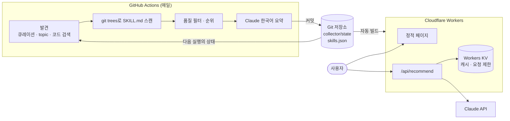

# 스킬서가

Claude Code, Codex, Cursor에서 쓰는 SKILL.md 기반 AI 에이전트 스킬을 한국어로 정리하고 추천하는 사이트입니다.

GitHub에서 스킬을 매일 수집하고, Claude API로 한국어 설명을 새로 쓰고, 정적 사이트로 배포합니다. 상시 서버와 DB 없이 동작합니다.

- 둘러보기: 카테고리 필터, 스타·업데이트·신규 정렬, 키워드 검색, 카드/표 보기
- 상세: 에이전트별 설치 명령, 원본 링크, 라이선스, 코드 실행·네트워크 접근 표시
- 맞춤 추천: 네 가지 질문을 브라우저에서 계산하고 결과를 URL로 공유
- 자연어 추천: 문장으로 물어보면 Claude가 카탈로그에서 골라 이유와 함께 제시

## 아키텍처



단계별 흐름과 파일 소유자는 [docs/data-flow.md](docs/data-flow.md)에 있습니다.

## 구조

```
collector/   Python 배치 (uv, httpx, tenacity, pydantic, anthropic)
  src/collector/domain/      외부 의존이 없는 모델과 규칙
  src/collector/sources/     GitHub와 큐레이션 목록 어댑터
  src/collector/pipeline/    수집·요약 흐름
  src/collector/summarize/   Claude API, 프롬프트, mock
  src/collector/export/      skills.json 계약과 출력
  state/                     커밋되는 수집 상태
site/        Astro + Cloudflare Workers
docs/adr/    설계 결정 기록
.github/     일일 수집 워크플로
```

## 설계 결정

| 결정 | 이유 | 기록 |
|---|---|---|
| 상시 서버 없이 Actions + Workers로 구성 | 읽기 위주 서비스라 고정비와 운영 부담을 없앨 수 있다. 어댑터의 Pages 지원 중단도 반영했다 | [ADR-0001](docs/adr/0001-serverless-architecture.md) |
| 상태와 결과를 JSON으로 커밋 | 러너가 초기화되어도 증분 수집이 이어지고, 데이터 변경이 커밋으로 추적된다 | [ADR-0002](docs/adr/0002-json-commit-and-state-files.md) |
| 저장소 스타를 감쇠와 상한으로 순위화 | 스타는 저장소 단위라, 큰 모음 저장소가 상위를 독점하는 것을 막아야 한다 | [ADR-0003](docs/adr/0003-ranking-with-repository-stars.md) |
| 자연어 추천을 인터페이스로 분리하고 KV로 비용 제한 | 300개 규모에는 단순한 방식이 맞고, 커지면 임베딩으로 교체할 수 있다 | [ADR-0004](docs/adr/0004-natural-language-recommendation.md) |

구현에서 특히 신경 쓴 부분은 다음과 같습니다.

- git tree의 blob SHA를 SKILL.md 해시로 써서, 본문을 받지 않고 변경과 중복을 판단합니다.
- 저장소마다 스캔한 `pushed_at`을 기록해, 레이트 리밋으로 멈춰도 다음 실행에서 이어집니다.
- 같은 입력은 같은 바이트의 파일을 만듭니다. 변경이 없으면 커밋도 없습니다.
- SKILL.md는 신뢰할 수 없는 외부 입력으로 다룹니다. 프롬프트에서 데이터로 분리하고, 출력은 스키마로 검증하고, 복사 여부를 검사하고, 설치 명령의 경로는 셸 인용합니다.

## 로컬 실행

필요한 도구: uv, Node.js 22.12 이상

```bash
# collector: 스킬 10개를 build/ 안에서만 처리한다
cd collector
uv sync
uv run pytest
uv run python -m collector --limit 10 --mock-summary

# site: 샘플 데이터로 실행한다
cd site
npm install
npm test
npm run check
npm run dev:sample
```

자연어 추천은 Worker 런타임이 필요합니다.

```bash
cd site
npm run build:sample
npx wrangler dev --var ANTHROPIC_API_KEY:<키>
```

## 운영 준비

1. GitHub Secrets에 `GH_SEARCH_TOKEN`(공개 저장소 읽기 전용 fine-grained PAT)과 `ANTHROPIC_API_KEY`를 등록합니다.
2. `npx wrangler kv namespace create RECOMMEND_KV`로 KV를 만들고 `site/wrangler.jsonc`의 `id`를 교체합니다.
3. `npx wrangler secret put ANTHROPIC_API_KEY`로 Worker에 키를 등록합니다.
4. Cloudflare Workers Builds에 저장소를 연결합니다. Root directory는 `site`, Build는 `npm run build`, Deploy는 `npx wrangler deploy`, 환경변수 `SITE_URL`에 실제 도메인을 넣습니다.
5. Actions에서 `Collect skills`를 `bootstrap` 모드로 한 번 실행합니다.

## 운영 지표

아직 운영 전이라 실측값이 없습니다. 첫 실행 후 이 표를 채웁니다.

| 지표 | 값 |
|---|---|
| 수집 저장소 수 | 측정 전 |
| 공개 스킬 수 | 측정 전 |
| 일일 수집 시간 | 측정 전 |
| 일일 요약 토큰 | 측정 전 |

실행마다 발견·신규·제외·요약 수, 소요 시간, 토큰 사용량이 Actions 요약과 `run-metrics` 아티팩트에 남습니다.

## AI 활용 개발 방식

이 프로젝트는 Claude Code와 함께 만들었고, 그 작업 방식도 저장소에 코드로 남겼습니다.

- `CLAUDE.md`: 구조, 원칙, 비밀값 규칙을 담은 작업 지침
- `.claude/settings.json`: 허용·차단 명령과 Python 파일 수정 후 ruff 검사 훅
- `.claude/skills/`: 소규모 검증과 소스 추가 절차
- `.claude/agents/summary-reviewer.md`: 요약을 원문과 대조하는 독립 리뷰 에이전트

사람은 범위와 설계 기준을 정하고 결과를 검토했습니다. AI가 쓴 코드는 fixture 기반 테스트, 타입 검사, 실제 브라우저 점검으로 검증했습니다.
