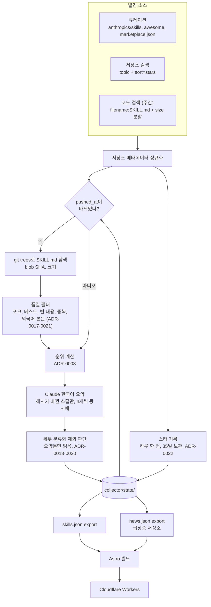
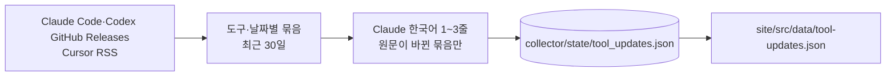

# 데이터 흐름

## 실행 모드

| 모드 | 언제 | 발견 범위 |
|---|---|---|
| `bootstrap` | 최초 1회 | 큐레이션 + topic 검색, `catalog_limit`을 채우면 중단 |
| `daily` | 3시간마다 | 알려진 저장소 갱신 + topic 검색 |
| `weekly` | 마지막 전체 탐색에서 7일이 지났거나, 이어서 읽을 범위(`code_search_pending`)가 남았을 때 | `daily` + 코드 검색 전수 조회. 실행당 90분씩 나눠 읽는다 |

`--limit N`을 주면 `collector/build/small/`에 격리된 상태로 N개만 처리하고, 샘플을 `collector/build/samples/`에 남긴다. 커밋 대상 파일은 건드리지 않는다.

## 파일과 소유자

| 경로 | 쓰는 쪽 | 읽는 쪽 | 커밋 |
|---|---|---|---|
| `collector/state/*.json` | collector | collector | O |
| `site/src/data/skills.json` | collector export | site | O |
| `site/src/data/news.json` | collector export | site | O |
| `collector/state/tool_updates.json` | 도구 소식 워크플로 | 도구 소식 워크플로 | O |
| `site/src/data/tool-updates.json` | 도구 소식 워크플로 | site | O |
| `site/src/data/skills.schema.json` | `python -m collector.export.schema` | 사람, 테스트 | O |
| `site/src/data/taxonomy.json` | `python -m collector.export.schema` | site, 테스트 | O |
| `site/src/data/skills.sample.json` | 사람 | 개발용 site | O |
| `collector/build/` | collector | 사람, `summary-reviewer` | X |

## 계약

- `skills.json`은 `Repository`와 `Skill`을 정규화해서 담는다. 스킬은 `repository`로 저장소를 참조한다.
- 요약이 없는 스킬은 내보내지 않는다.
- `config.toml`의 `[exclude]` 목록과, 분류가 빈 페이지·예제로 판단한 스킬은 내보내지 않는다 (ADR-0020). `keep`에 있으면 판단과 상관없이 내보낸다.
- `collector/state/summaries.json`의 `summary_redo`는 검수에서 걸린 요약 목록이다. 다음 실행이 먼저 다시 만들고, 그때까지는 기존 요약을 보여 준다. 다시 만들지 못하면 기존 요약을 두고 목록에서 뺀다.
- 모델을 바꾸면 `skills.schema.json`을 재생성한다. 테스트가 불일치를 잡는다.

## 도구 소식 (ADR-0022)

스킬 수집과 다른 워크플로(`.github/workflows/tool-news.yml`, 6시간마다)가 `python -m collector --tool-news`로 돈다.

두 워크플로는 서로 다른 파일만 커밋한다. 스킬 수집은 `tool_updates.json`을 읽기만 하고, 도구 소식은 다른 상태 파일을 바꾸지 않는다. 그래서 동시에 끝나도 rebase가 충돌하지 않는다.
