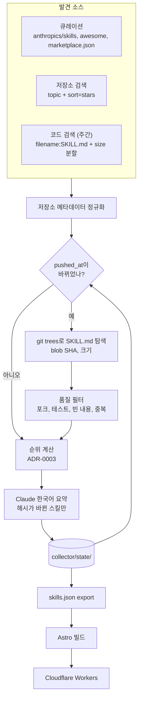

# 데이터 흐름

## 실행 모드

| 모드 | 언제 | 발견 범위 |
|---|---|---|
| `bootstrap` | 최초 1회 | 큐레이션 + topic 검색, `catalog_limit`을 채우면 중단 |
| `daily` | 3시간마다 | 알려진 저장소 갱신 + topic 검색 |
| `weekly` | 주 1회 (일요일 18시 UTC) | `daily` + 코드 검색 전수 조회 |

`--limit N`을 주면 `collector/build/small/`에 격리된 상태로 N개만 처리하고, 샘플을 `collector/build/samples/`에 남긴다. 커밋 대상 파일은 건드리지 않는다.

## 파일과 소유자

| 경로 | 쓰는 쪽 | 읽는 쪽 | 커밋 |
|---|---|---|---|
| `collector/state/*.json` | collector | collector | O |
| `site/src/data/skills.json` | collector export | site | O |
| `site/src/data/skills.schema.json` | `python -m collector.export.schema` | 사람, 테스트 | O |
| `site/src/data/skills.sample.json` | 사람 | 개발용 site | O |
| `collector/build/` | collector | 사람, `summary-reviewer` | X |

## 계약

- `skills.json`은 `Repository`와 `Skill`을 정규화해서 담는다. 스킬은 `repository`로 저장소를 참조한다.
- 요약이 없는 스킬은 내보내지 않는다.
- 모델을 바꾸면 `skills.schema.json`을 재생성한다. 테스트가 불일치를 잡는다.
